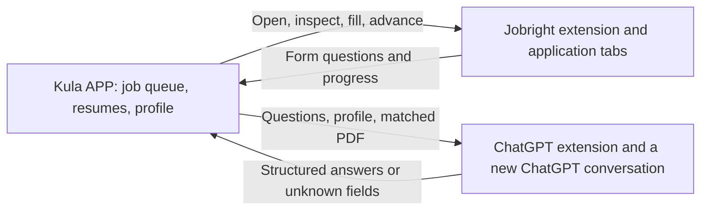

# Kula application automation

Kula APP coordinates the existing Jobright extension and a second extension installed in the browser profile signed in to ChatGPT. **Start automatically submits completed applications.** The job links, matching resume PDFs, and saved profile are the inputs for the run.

## Set up the two browsers

1. Download the latest successful **KulaAPP-windows-x64** artifact from the repository's **Build Kula APP for Windows** workflow. Extract it before running **KulaAPP.exe**.
2. Load the package's **extension** directory as an unpacked extension in the browser profile you use for Jobright. Reload an existing installation and refresh Jobright.
3. Load **chatgpt-extension** as an unpacked extension in the browser profile signed in to your ChatGPT account. The two extensions may be in different browser profiles or browsers on the same Windows computer.
4. Keep your Jobright and ChatGPT accounts signed in. Kula does not enter passwords or solve account challenges.
5. In Kula APP, open **Automation** and click **Copy connection key**. This starts the authenticated local command connection.
6. Paste and connect using that key in each extension's popup. The Jobright runner requests access to application websites because employers use different HTTPS domains. The ChatGPT extension needs only ChatGPT and the local app connection.
7. Confirm that the Automation tab reports both browsers connected.

No API key, Python installation, .NET installation, or native-host registration is required to run the packaged app. The local connection listens only on `127.0.0.1:43127`. Its key is stored in `%LOCALAPPDATA%\KulaAPP\pairing-key.txt`; keep it private.

## Run the queue

1. In **Jobs**, use **Export job links** to load the TXT file downloaded from the Jobright extension.
2. Use **Import Resumes** to select the matching PDF folder. Check each job/resume pairing in the table. Automation accepts PDFs up to 8 MB each.
3. In **Package**, enter your profile and click **Save Profile**. Start uses the saved profile, including your explicit citizenship, veteran, gender, and race answers. Full Name is required to start; unspecified answers remain unspecified.
4. Click **Start**. The app snapshots the current list, resumes, and saved profile, then processes one job at a time.
5. Watch the Status column. **Submitted** requires observed confirmation from the application page. **Needs attention** means the app could not safely complete a required step. A missing confirmation is treated as uncertain rather than a successful submission.

The ChatGPT extension opens its own conversation tab for the job and attaches the matched PDF. The job context, form questions, and saved profile are sent to that ChatGPT conversation to draft answers. It does not read existing conversations or replace drafts in your normal tabs. ChatGPT account upload limits, generation limits, and website UI changes can prevent a job from completing.

The app uses ordinary form controls and existing dropdown choices. It stops on required unknown facts, login, CAPTCHA, required legal attestations/consent, or unsupported widgets. It does not invent missing qualifications or infer demographic answers. ChatGPT's output is treated as answer data, not browser commands.

## Stop and submission history

**Stop** cancels the run and revokes authorization for the next browser action. It cannot undo an application already submitted, and an action already in progress may finish. Check the open application tab if stopping around the final submit step.

Kula records final submission attempts in `%LOCALAPPDATA%\KulaAPP\application-history.json`. A confirmed submission or an uncertain final submission is skipped on later runs to prevent automatic duplicate applications. Review the browser and history before deciding how to handle an uncertain result. Loading another TXT file does not erase this history.

TXT and resume imports are locked while a run is active. The job/resume mapping and saved profile are fixed for the run. Each PDF is read and checked again when its job starts; avoid editing or moving those files during a run. The same PDF bytes are then used for that job's ChatGPT request and application upload.

## Supported forms and validation limits

This first adapter supports visible, standard HTML fields in the main application page: text fields, text areas, selects, radio groups, checkboxes with supplied answers, and identifiable PDF resume uploads. The matched PDF must be acknowledged before advancing a form; flows that only offer a resume uploader later may need manual attention. It follows explicit application links and clearly marked dialog openers. An ambiguous one-click apply control is left for attention so it cannot submit using a different previously saved resume.

Custom multi-step widgets, embedded cross-origin frames, e-signatures, special file uploaders, and employer-specific workflows may need additional adapters. A Jobright URL alone does not establish that its application flow is supported.

Local fixture tests exercise form inspection, filling, uploads, answer parsing, cancellation, and orchestration. They do not establish compatibility with every live employer or with future Jobright/ChatGPT UI changes. The cloud browser policy prevents loading unpacked extensions here; installation and live account behavior need validation in your Windows browsers.

## Development command protocol

Both extensions authenticate to the fixed local endpoint with a bearer key. The client role is `jobright` or `chatgpt`, and each browser installation has a stable client UUID.

- `POST /v1/connect` registers a role/client.
- `POST /v1/poll` long-polls for a command, delivered once.
- `POST /v1/authorize` checks the active run before a browser side effect.
- `POST /v1/result` returns a correlated command result.

Commands carry a unique command ID and run ID. Unknown, expired, canceled, and mismatched results are rejected. Browser workers persist command claims so restarting a worker does not replay a prompt or submission. The app does not expose an unauthenticated endpoint for reading resumes or profile information.
